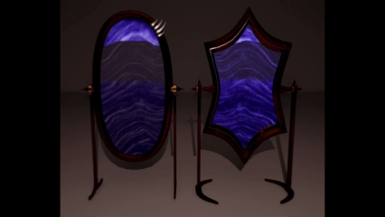
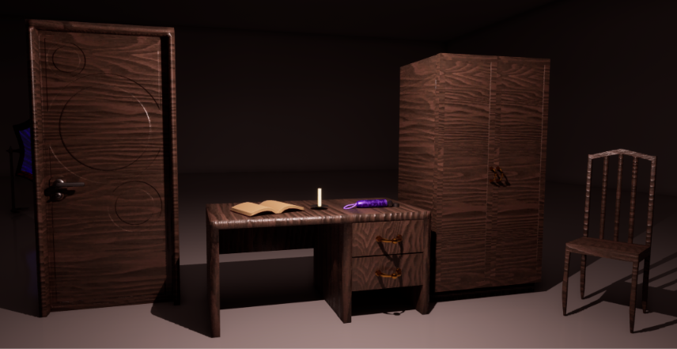
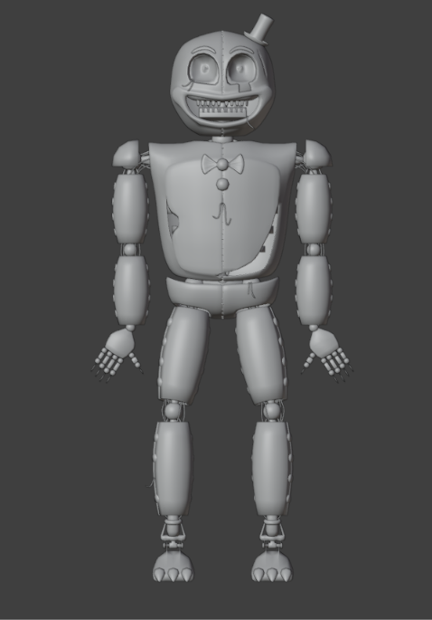
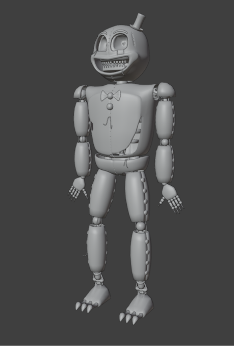
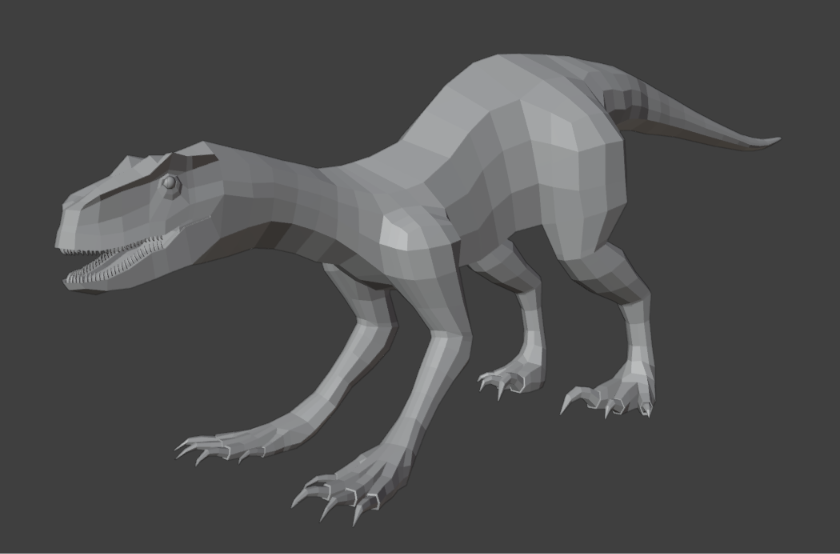
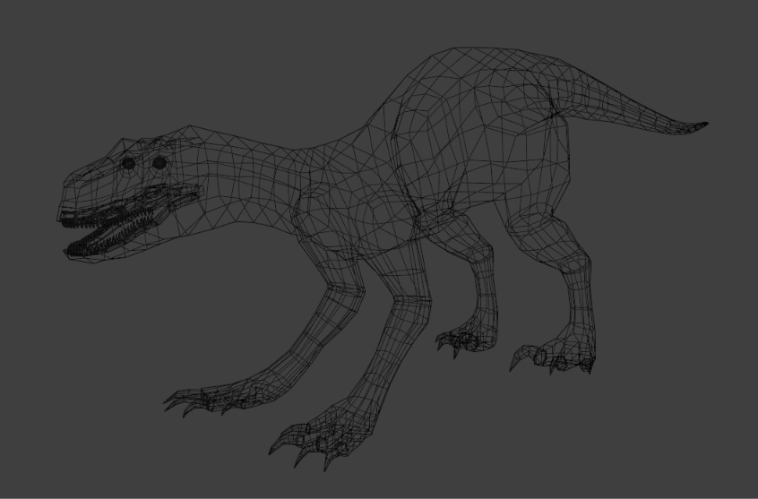
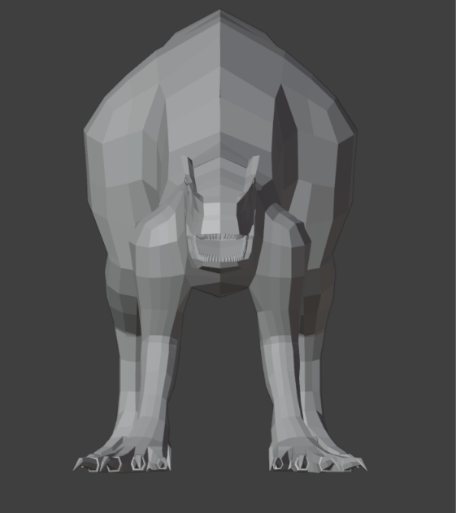

# 3D Modeling & Technical Art Portfolio

A curated collection of real-time 3D assets, shaders, environments, and character models built for **Game Jams** and **indie/production game development teams**. Focused on clean topology, modular workflows, and direct Unreal Engine integration.

---

## Hero Asset — GLASSFIRE (Unreal Engine)

  

Two stylized hero mirror variants (**Oval** and **Gothic**) created for the **GLASSFIRE** project, pairing custom **Blender** modeling with a **dynamic animated purple surface shader** in **Unreal Engine**.

- **Modeling & Variants:** Custom-modeled standing frames in Blender featuring distinct silhouettes—an oval frame accented with metallic claw details and a pointed gothic frame on curved crescent stands.
- **Dynamic Surface Shader:** Real-time animated violet/purple rippling material built in Unreal Engine to create a living, otherworldly reflective surface without heavy performance overhead.
- **Game-Ready Integration:** Clean pivot placement, real-time shadow casting, and scene-ready scale for immediate level placement and interactive gameplay triggers.

---

## Interior Environment & Prop Pack (Unreal Engine)

  

A cohesive **interior furniture and prop pack** modeled, UV-mapped, textured, and staged directly inside **Unreal Engine**.

- **Scene Assets:** Carved wooden door with circular motifs, two-door wardrobe, drawer desk with metallic handles, slatted wooden chair, and tabletop storytelling props (**open book, candle, and purple flashlight**).
- **UV & Material Pipeline:** Consistent texel density, clean game-ready UV layouts, and wood/metal material assignments tuned for atmospheric real-time lighting.
- **Staging & Lighting:** Assembled in an Unreal Engine test environment to validate asset scale proportions, silhouette readability, and shadow response under dramatic indoor lighting.

---

## Character Sculpt / Base Mesh — Animatronic Character

| Front View | 3/4 Perspective View |
| :---: | :---: |
|  |  |

An **untextured and unrigged** character sculpt/base mesh focused on primary form, readable silhouette, and layered mechanical construction.

- **Form & Silhouette:** Stylized proportions combining classic animatronic stagewear (top hat, bow tie) with damaged outer casing and stitched seam details.
- **Mechanical Endoskeleton:** Exposed internal endoskeleton hardware across the shoulders, elbows, hips, knees, ankles, jaw mechanism, and breached torso cavity to support future modular breakdown or rigging.

---

## Game-Ready Low-Poly Character — Dinosaur

| Solid Shading | Wireframe Topology |
| :---: | :---: |
|  |  |

A **game-ready low-poly creature mesh** designed around strict polygon efficiency and clean deformation-friendly topology.

- **Clean Edge Flow:** Structured loops around the jaw, neck, shoulders, hips, and limbs to support clean rigging and animation.
- **Low-Polygon Budget:** Economical silhouette construction that preserves sharp predator features (teeth, claws, brow ridge, tail taper) while keeping vertex counts lightweight for real-time engines and Game Jam performance budgets.

Additional Angle — Front Silhouette View

  

---

## Core Workflow

- **3D Modeling & Retopology:** Blender (hard-surface, character blockouts/sculpts, low-poly optimization, clean UV unwrapping)
- **Engine & Technical Art:** Unreal Engine (real-time shaders, material instances, lighting, level staging, game-ready asset integration)
